# fmux

### Multiple backends. One endpoint.

**A lightweight, macOS-oriented gateway that connects `fm`, curl and OpenAI-compatible clients to local inference servers and remote GPU backends.**

Keep one API address and choose a model by alias. fmux handles routing, streaming compatibility and configurable local process supervision, so your applications do not need to manage each backend separately.

**English** · [简体中文](README.zh-CN.md)

[](https://github.com/isLinXu/fmux/actions/workflows/ci.yml)
[](https://github.com/isLinXu/fmux/actions/workflows/release.yml)
[](https://github.com/isLinXu/fmux/releases)
[](go.mod)
[](LICENSE)
[](#install)

<picture>
  <source media="(prefers-color-scheme: dark)" srcset="docs/assets/fmux-arch-dark.svg">
  
</picture>

> fmux is the gateway, not the model runtime. Your backend runs the model; fmux gives clients a consistent way to reach it.

[Why fmux](#why-this-exists) · [Install](#install) · [Try it](#quick-start) · [Connect a model](#connect-a-real-model) · [Features](#features) · [Documentation](#documentation)

## Why this exists

Switching between Ollama, llama.cpp, MLX and a remote GPU server should not require changing every client. Nor should trying a local model require leaving every inference process running all day.

fmux provides one entry point at `http://127.0.0.1:1976/v1`, with stable model aliases and a small operational layer around your backends.

| When you want to… | fmux helps you… |
|---|---|
| Use Apple's `fm` CLI with your own models | Point its custom provider at a gateway that normalizes known `fm` wire-format quirks |
| Change model servers without rewriting clients | Keep aliases such as `chat` while changing their backend/model mapping |
| Combine a Mac model with a remote GPU model | Route both through the same endpoint, with an explicit fallback order |
| Run llama.cpp or MLX only when needed | Start configured child processes on demand and reclaim them after an idle period |
| Understand slow or failed requests | Inspect process state, request logs, queues and Prometheus metrics |

**Local when you choose local.** fmux sends local-target requests to your local server and remote-target requests to the configured remote server. Storage, logging and any onward forwarding by that backend depend on its own settings. fmux does not unlock Apple Intelligence or Private Cloud Compute.

## Requirements

| Requirement | What you need |
|---|---|
| Platform | macOS, Apple Silicon or Intel. Remote HTTP use on other systems is not the primary distribution target. |
| Real inference | An installed model and either a running external backend or a configured supervised command. No backend or weights are needed for the mock demo. |
| Build from source | Go 1.24+. The gateway itself does not require Python; your inference backend may. |
| Client | `fm` is optional. curl and clients supporting configurable OpenAI-compatible chat endpoints also work. |

## Install

**Homebrew**

```bash
brew install isLinXu/tap/fmux
```

<details>
<summary>Go install or build from source</summary>

```bash
go install github.com/isLinXu/fmux/cmd/fmux@latest
```

Or:

```bash
git clone https://github.com/isLinXu/fmux.git
cd fmux
make build
./bin/fmux version
```

Source-build examples below can use `./bin/fmux` in place of `fmux`. For Go installs, ensure your Go binary directory is on `PATH`.

</details>

## Quick start

### Try the gateway without a model

In one terminal:

```bash
fmux serve --mock --listen 127.0.0.1:1976
```

In another:

```sh
curl --noproxy '*' http://127.0.0.1:1976/v1/chat/completions \
  -H 'Content-Type: application/json' \
  -d '{"model":"mock-model","stream":true,"messages":[{"role":"user","content":"Hello, fmux!"}]}'
```

You should receive SSE `data:` events and a final `[DONE]`. **This is a deterministic mock response, not model inference.** It checks the client-to-gateway path without downloading weights.

Already using port 1976? Choose another port and update the client URL; do not start a second gateway on the same port.

### Connect a real model

For this example, [install Ollama](https://ollama.com/download/mac). If its app/server is not already running, run `ollama serve` in a separate terminal. Check that the local server is reachable:

```sh
curl --noproxy '*' http://127.0.0.1:11434/v1/models
```

Then ensure it has `qwen3:8b`:

```sh
ollama pull qwen3:8b
```

That command downloads model weights. Check available disk space and the model's memory requirements; substitute a smaller or already installed model if needed, and use its exact backend model ID in the YAML.

Create `fmux.yaml`:

```yaml
listen: 127.0.0.1:1976
backends:
  - name: ollama
    type: ollama
    url: http://127.0.0.1:11434/v1
    models: ["qwen3:8b"]
    max_concurrency: 1
    queue_depth: 4
aliases:
  chat: { backend: ollama, model: "qwen3:8b" }
  chat-short: { backend: ollama, model: "qwen3:8b", profile: concise }
profiles:
  concise: { temperature: 0.2, max_tokens: 256 }
```

Stop the mock demo before starting the real gateway on the same port:

```sh
fmux serve --config ./fmux.yaml
```

From another terminal, use curl:

```sh
curl --noproxy '*' http://127.0.0.1:1976/v1/chat/completions \
  -H 'Content-Type: application/json' \
  -d '{"model":"chat","stream":true,"messages":[{"role":"user","content":"Explain Swift in two sentences."}]}'
```

If Apple's `fm` is installed (`fm --help`), you can use it without changing its saved default provider. Otherwise, use curl:

```sh
fm respond --model-provider http://127.0.0.1:1976/v1 --model chat \
  'Explain Swift in two sentences.'
fm chat --model-provider http://127.0.0.1:1976/v1 --model chat-short
```

Here `chat` is the client-facing alias; `qwen3:8b` is the backend's model ID. Change the mapping later without changing the client. `chat-short` applies sampling defaults, not a guaranteed speed improvement.

## Configuration

### One Mac, plus a remote GPU

This is a separate, complete configuration. Replace the addresses and model IDs with your own; the remote server must already be running. If it requires authentication, add `api_key` under that backend. Prefer HTTPS for remote access; the HTTP address below assumes a trusted network.

```yaml
listen: 127.0.0.1:1976
backends:
  - name: ollama
    type: ollama
    url: http://127.0.0.1:11434/v1
    models: ["qwen3:8b"]
  - name: gpu-server
    type: vllm
    url: http://10.0.0.20:8000/v1
    # api_key: "replace-with-your-backend-key"
    models: ["Qwen/Qwen3-8B"]
aliases:
  local-chat: { backend: ollama, model: "qwen3:8b" }
  remote-chat: { backend: gpu-server, model: "Qwen/Qwen3-8B" }
  auto: { fallback: ["local-chat", "remote-chat"] }
```

Select `auto` as the client model. fmux tries the declared targets in order; it can fall back **before a response has been written**, not splice another model's answer into a stream already in progress. With this configuration, a failed local attempt may send the same request to the remote server. Select `local-chat` when you do not want remote fallback. See the [architecture guide](docs/architecture.md) for error and breaker behavior.

`api_key` is a literal configuration value; `${VARIABLE}` is not automatically expanded. Keep credentials out of version control.

The full [example configuration](configs/config.example.yaml) covers supervised processes, sampling profiles, queues, timeouts and memory estimates.

## Features

| Capability | What it provides |
|---|---|
| Unified chat API | `/v1/chat/completions` and `/v1/models`, with model aliases and capability metadata |
| Streaming compatibility | Known `fm` request normalization, SSE handling, completion tails and estimated usage when needed |
| Backend choice | Ollama, llama.cpp, MLX-LM, LM Studio, remote vLLM/SGLang and generic OpenAI-compatible servers |
| Process supervision | Demand-start, health checks, reuse and idle reclamation for backends configured with a `command` |
| Resource controls | Per-backend concurrency limits, bounded queues and advisory LRU memory accounting with pin-aware selection |
| Failure handling | Ordered fallback, backend circuit breakers, cancellation propagation and stream idle/total deadlines |
| Operations | Structured logs, Prometheus metrics, diagnostics and macOS LaunchAgent support |

Vision, tools and structured output depend on the backend **and the loaded model**. Type-based capabilities are defaults, not proof that a particular server build supports them. `fmux doctor --caps` probes that support with real requests; prompt-based JSON fallback is not native schema enforcement.

## How it works

```text
Client request
  -> Host/Origin checks and fm normalization
  -> Alias resolution and capability checks
  -> Backend slot or bounded queue
  -> Model pin and local process preparation
  -> Backend inference and response streaming
```

Admission comes before expensive local startup. Supervised backends start on demand and are reclaimed after an idle period; externally managed servers keep their own lifecycle. On shutdown, fmux drains requests within its configured deadline before stopping its children.

See [Architecture](docs/architecture.md) for the request pipeline, process ownership, queues and failure handling.

## Operations

```sh
fmux ps --gateway http://127.0.0.1:1976
fmux doctor --config ./fmux.yaml
curl --noproxy '*' http://127.0.0.1:1976/metrics
```

`ps` reads the running gateway. `doctor` checks the configuration and backend connectivity; add `--probe` for memory diagnostics or `--caps` for capability probes. Capability probes send real requests to configured backends.

For a macOS LaunchAgent, initialize the default configuration (skip this if it already exists):

```sh
fmux config init
```

**Edit `~/.fmux/config.yaml` to match your backends**, and stop any foreground gateway using the same port. Then install:

```sh
fmux service install
fmux service status
```

The service uses the default config, not the `./fmux.yaml` from the example above. Use either `fmux service` or `brew services` to manage the gateway, not both. See [Deployment](docs/deployment.md) for logs, restart, drain settings and troubleshooting.

## Endpoints

| Path | Purpose |
|---|---|
| `POST /v1/chat/completions` | Streaming and non-streaming chat |
| `GET /v1/models` | Aliases with their capabilities (`stream`, `vision`, `json_schema`, `tools`) and context length, plus backend-reported models |
| `GET /healthz` | Liveness |
| `GET /metrics` | Prometheus text: requests, tokens, latency and TTFT histograms, evictions, inflight, queue waits, rejections |
| `GET /admin/backends` | Capability matrix, health, admission policy and circuit state per backend |
| `GET /admin/processes` | Supervised processes and memory residency |
| `GET /admin/config` | Effective configuration |

## Boundaries

- **Chat compatibility, not the entire OpenAI API.** Responses, embeddings, audio and image-generation endpoints are not implemented.
- **No Apple model unlock.** Custom backend routing does not bypass Apple Intelligence or Private Cloud Compute eligibility, availability or licensing.
- **Local single-user deployment.** Loopback binding and Host/Origin checks are not multi-tenant authentication. Do not expose the gateway directly to an untrusted network.
- **Advisory memory accounting.** `memory_mb` is an estimate; `budget_mb` guides reclamation and may be exceeded. It is not an enforced RSS limit or a guarantee against swap or unload failures.
- **TTFT is request-level latency.** It measures from successful validation/normalization to the first successfully written text or tool-function output, including queueing, preparation and earlier fallback attempts. It is not a cold-load-only metric or a measurement of terminal display time.
- **Runtimes remain separate.** fmux does not download or quantize models. Local process management targets macOS; vLLM and SGLang are used as remote servers.

## Documentation

| Start here | What you will find |
|---|---|
| [Example configuration](configs/config.example.yaml) | Backends, aliases, profiles, supervision, queues and timeouts |
| [Architecture](docs/architecture.md) | Request lifecycle, resource accounting and failure handling |
| [Backend adapters](docs/adapters.md) | Backend setup and capability differences |
| [`fm` compatibility](docs/fm-compat.md) | Captured wire formats, normalization and replay procedure |
| [Deployment](docs/deployment.md) | LaunchAgent management, diagnostics and troubleshooting |
| [Functional verification](docs/fm-functional-verification.md) | Real CLI tests and environment limitations |
| [Protocol and metrics verification](docs/fmux-repair-verification.md) | SSE errors, fallback boundaries, metadata and metric export |
| [TTFT verification](docs/ttft-verification.md) | Timing definition and regression evidence |

## Verification

The repository includes unit, race, captured-protocol and end-to-end tests, plus real `fm` and local-model verification reports. The reports record tested versions, conditions and known limitations; they are not a guarantee for every macOS version, model or released binary.

## Development

```bash
make build           # build bin/fmux
make test            # unit + conformance + e2e (skips fm/python tests if absent)
make vet             # static checks
make conformance     # only the real-fm tests
make e2e             # only the process-supervision tests
make capture         # re-record golden samples from the installed fm binary
make release-check   # goreleaser check + snapshot build
```

After a macOS update, `make capture` helps detect changes in the installed `fm` wire format. For concurrency checks, run `go test -race ./...`; for documentation links, run `python3 scripts/check_docs.py`.

<details>
<summary>Repository map</summary>

```text
cmd/fmux/             CLI and service commands
internal/api/         HTTP API, SSE and loopback guards
internal/compat/      fm request normalization
internal/router/      Aliases, capabilities and profiles
internal/adapter/     Backend integration
internal/supervisor/  Child process lifecycle
internal/budget/      Memory accounting and eviction selection
internal/gate/        Concurrency and bounded queues
internal/breaker/     Backend circuit state
internal/metrics/     Prometheus export
test/                 Protocol captures, conformance and fixtures
docs/                 Guides and verification evidence
```

</details>

Bug reports, backend compatibility findings and pull requests are welcome. When opening an [issue](https://github.com/isLinXu/fmux/issues), include your fmux/macOS/backend versions, a minimal redacted configuration and a reproducible request. Remove API keys and sensitive prompts from logs.

## License

[MIT](LICENSE)
