# fmux

**One OpenAI-compatible endpoint in front of every local inference server on macOS — so `fm`, Apple's built-in Foundation Models CLI, can drive all of them.**

[](https://github.com/isLinXu/fmux/actions/workflows/ci.yml)
[](https://github.com/isLinXu/fmux/actions/workflows/release.yml)
[](https://github.com/isLinXu/fmux/releases)
[](go.mod)
[](LICENSE)
[](#install)

<picture>
  <source media="(prefers-color-scheme: dark)" srcset="docs/assets/fmux-arch-dark.svg">
  
</picture>

---

## Contents

- [Why this exists](#why-this-exists)
- [Features](#features)
- [Requirements](#requirements)
- [Install](#install)
- [Quick start](#quick-start)
- [Configuration](#configuration)
- [How it works](#how-it-works)
  - [Request lifecycle](#request-lifecycle)
  - [Process and memory model](#process-and-memory-model)
  - [Admission control](#admission-control)
  - [Failure handling](#failure-handling)
  - [Shutdown](#shutdown)
  - [Trust boundary](#trust-boundary)
  - [Observability](#observability)
  - [Running as a service](#running-as-a-service)
- [Endpoints](#endpoints)
- [The `fm` quirks this handles](#the-fm-quirks-this-handles)
- [Verification](#verification)
- [Project layout](#project-layout)
- [Development](#development)
- [Non-goals](#non-goals)
- [License](#license)

---

## Why this exists

`fm` ships with macOS and speaks a clean OpenAI-compatible dialect, but it can reach only three places: the on-device Apple model, Private Cloud Compute, and a single custom provider. On a machine where Apple Intelligence is unavailable — region-gated, or without model assets — the first two are dead ends, and the third is a bare URL with no aliasing, no capability routing and no fallback.

`fmux` turns that single URL into a proper gateway. `fm` stays the client; the gateway becomes the abstraction layer.

A second reason, and the one that shapes the code: **`fm`'s wire format has quirks that strict backends reject.** Every one of them was captured from the real binary into `test/conformance/golden/` and is replayed by the test suite on every run.

A third reason decides the architecture: **a generic HTTP proxy assumes every backend is an always-on endpoint.** On a Mac that assumption is wrong. llama.cpp and MLX serve one model per process; an 18 GB checkpoint takes tens of seconds to load; leaving it resident after the last request is how a 128 GB machine starts swapping; and on Apple Silicon the GPU shares RAM with the CPU, so there is no separate VRAM to budget. So the gateway also owns process lifecycle and a unified memory pool. Nothing here is vendor-specific — a remote vLLM over HTTP is just another target, and a generic proxy can sit in front of it if you want one.

## Features

| Capability | What it gives you |
|---|---|
| **OpenAI-compatible surface** | `POST /v1/chat/completions` with SSE streaming, synthesized `finish_reason` / usage / `[DONE]` so inconsistent backends still satisfy strict clients |
| **One namespace, many backends** | Ollama, llama.cpp, MLX, LM Studio, vLLM, SGLang behind aliases; clients never learn the backend's model id |
| **Process supervision** | Backends with a `command` are started on first request, health-probed, reused, and stopped after `idle_timeout` |
| **Unified memory budget** | One pool across resident models on Apple Silicon, LRU eviction, in-use models pinned so a live generation is never evicted |
| **Admission control** | Per-backend semaphore plus bounded wait queue — saturation is `429` with `Retry-After`, not a swap spiral |
| **Circuit breaker** | Three consecutive *gone* failures open a backend for 30 s; `400`/`429`/client-cancel deliberately do not count |
| **Draining shutdown** | `SIGTERM` stops accepting, finishes in-flight generations, *then* stops the children — in that order |
| **Loopback guard** | `Host`/`Origin` checked before routing, so DNS rebinding cannot turn a visited page into a client |
| **Real histograms** | Time-to-first-token and total duration tracked separately, because one average cannot tell a long answer from a cold load |
| **Single static binary** | Runs under `launchd` with no runtime, no Python, no plugin loading |

<details>
<summary>Milestone history</summary>

| Milestone | Scope |
|---|---|
| M0 | Wire fidelity, HTTP layer, SSE, golden tests |
| M1 | Ollama adapter, alias routing, capability matrix |
| M2 | llama.cpp + process supervisor |
| M3 | MLX / LM Studio, memory budget, LRU unload |
| M4 | vLLM / SGLang remote, fallback chains |
| M5 | Metrics, structured logs, bench |
| M6 | Homebrew formula, LaunchAgent, release pipeline, docs |
| M7 | Admission control, stream idle, loopback guard |
| M8 | Drain on shutdown, busy-aware reaping, circuit breaker, latency histograms |

</details>

## Requirements

| Requirement | What you need |
|---|---|
| **OS** | macOS, arm64 or amd64. Remote-only backends work on Linux, but that is not a shipped build target. |
| **A backend** | Ollama, llama.cpp, MLX-LM, LM Studio, vLLM or SGLang. None needed to try it out: `fmux serve --mock` runs the whole path with a deterministic fake. |
| **Go 1.24+** | Only for `go install` or building from source. The Homebrew tap ships a prebuilt binary. |
| **`fm`** | Optional. The gateway is a plain OpenAI-compatible endpoint; `fm` is one client among others. |

## Install

### Homebrew

```bash
brew install isLinXu/tap/fmux
brew services start fmux    # run at login, restart on crash
fmux config init            # -> ~/.fmux/config.yaml
fmux doctor                 # config, backends, aliases, port, fm wiring
```

The tap ships a prebuilt binary for the release tag, so no Go toolchain is needed.

### Go

```bash
go install github.com/isLinXu/fmux/cmd/fmux@latest
fmux config init
fmux service install
```

### From source

```bash
git clone https://github.com/isLinXu/fmux && cd fmux
make install                # -> ~/.local/bin/fmux
fmux config init            # -> ~/.fmux/config.yaml
fmux service install        # run at login, restart on crash
fmux doctor                 # config, backends, aliases, port, fm wiring
```

The full operational guide — plist layout, the `launchctl` EIO trap, upgrades, removal — is in [docs/deployment.md](docs/deployment.md).

## Quick start

Point `fm` at the gateway. `fm` keeps its providers in `~/.fm/config.json`, so the whole setup is three commands:

```bash
fm config add model-provider fmux http://127.0.0.1:1976/v1
fm config set default-model-provider fmux
fm config set default-model qwen3.8:27b
```

```console
$ fm models
✓ qwen3.8:27b

$ fm chat
```

Every alias declared in the gateway becomes a model here.

No backend handy? `fmux serve --mock` starts a deterministic fake backend, so the entire path — `fm` → gateway → SSE → terminal — can be exercised without a single weight on disk.

## Configuration

```yaml
listen: 127.0.0.1:1976

backends:
  - name: ollama
    type: ollama                      # ollama|llamacpp|mlx|lmstudio|vllm|sglang|openai|mock
    url: http://127.0.0.1:11434/v1
    models: ["qwen3.8:27b"]
    max_concurrency: 1                # one GPU, one request at a time
    queue_depth: 4                    # then 429 + Retry-After

  - name: vllm-lab
    type: vllm
    url: http://10.0.0.20:8000/v1
    api_key: ${VLLM_KEY}

aliases:
  qwen3.8:27b: { backend: ollama, model: "qwen3.8:27b" }
  qwen-fast:   { backend: ollama, model: "qwen3.8:27b", profile: fast }
  auto:        { fallback: ["qwen3.8:27b", "qwen-remote"] }

profiles:
  fast: { temperature: 0.2, max_tokens: 512 }
```

`type` decides the capability matrix and whether the backend is treated as **local** (process-managed, budget-accounted) or **remote** (HTTP only). See [docs/adapters.md](docs/adapters.md) for the per-type capability table.

---

## How it works

The rest of this section explains the design decisions that make the gateway behave correctly on a machine with one GPU and a shared memory pool. If you only want to run it, the [Quick start](#quick-start) is enough; for the layer-by-layer walkthrough, see [docs/architecture.md](docs/architecture.md).

### Request lifecycle

```text
POST /v1/chat/completions
  |  guard        Host / Origin must be loopback          -> 403 otherwise
  |  decode       polymorphic content, absent fields
  |  normalize    drop empty system messages, nil out tools:[]
  |  resolve      alias -> ordered []Target
  |  breaker      skip targets whose circuit is open
  |
  +-- for each target, in order:
        prepare     capability gate + profile defaults   -> 400 on mismatch
        gate        slot, or bounded wait                -> 429 on overflow
        pin         this model must not be evicted now
        adapter     start the process, acquire memory
        stream      SSE, bounded by stream_idle
        breaker     succeed -> return; gone -> next target
```

**The order of `gate` before `Prepare` is load-bearing.** Admission first, because starting an 18 GB process or evicting a resident model for a request that will only queue is wasted work, and because N concurrent cold requests would otherwise all try to start the same backend. Prepare second, because once a slot is held the caller owns the backend and may safely block on a cold start.

### Process and memory model

This is the part that does not exist in a pure HTTP router, and the reason the project is macOS-specific rather than another LiteLLM.

**Processes are demand-started.** A backend with a `command` is not started at boot. The first request to one of its aliases calls `supervisor.Ensure`, which spawns the process and polls its health endpoint until it answers or `startup_timeout` expires. Later requests reuse the process. A background watcher stops it once `idle_timeout` passes with no requests, releasing its budget entry through the supervisor's `onStop` hook.

```yaml
- name: llamacpp-8b
  type: llamacpp
  url: http://127.0.0.1:8080/v1
  command: ["llama-server", "-m", "/models/Qwen3-8B-Q4_K_M.gguf", "--port", "8080"]
  memory_mb: 6144        # feeds the budget
  idle_timeout: 15m      # unload after this long with no requests
  startup_timeout: 120s  # wait this long for /health before giving up
```

Idle is measured from the **end** of the last request, not its start. A request that outlives `idle_timeout` — a long generation on a small machine — holds an in-flight claim on the process, so the reaper skips it and the clock restarts when it finishes. Otherwise a model that is busy working would be killed for being idle.

**Memory is a single pool.** On Apple Silicon the GPU shares RAM with the CPU, so "VRAM" is not a separate budget. `budget_mb` caps the sum of `memory_mb` over resident models; acquiring a new one evicts the least recently used first — `keep_alive: 0` for Ollama, a process stop for supervised backends. Eviction is advisory: an oversized model is still admitted with a warning, because a wrong estimate should not turn into a failed request.

> Set the budget so it is reached **before** the swap file is. On a 128 GB Mac, 40 GB is a more useful ceiling than 96: a model that fits but leaves the machine swapping runs at a tenth of its speed, and nothing in the gateway can tell you that from the inside.
>
> `memory_mb` should come from `ollama ps` or a process's RSS, not from the parameter count — the same 27B weighs 17 GB or 27 GB depending on the context length its checkpoint declares, because the KV cache is sized from that number.

**In-use models are pinned.** LRU alone is not safe: the least recently used model may be the one currently generating on another backend, and unloading it would kill a request halfway through an answer. Every request pins its model for its lifetime, and eviction skips pinned residents. If every candidate is pinned, the load proceeds over budget and logs why.

**Three levels of process, one owner each.** The gateway itself is a launchd job (`com.fmux.gateway`, managed by `fmux service`). The inference servers it supervises are its children, started and stopped by request pressure and `idle_timeout`. Ollama and LM Studio are owned by nobody here — they have their own managers, so the gateway only talks to their HTTP API. The rule is: one owner per process, and the gateway never fights another manager for the same server.

### Admission control

A local model is not a web service. A 27B checkpoint on a Mac answers one request at a time: the second concurrent request does not halve the latency, it doubles the KV cache and pushes a shared-memory machine toward swap. A router that forwards everything immediately is therefore not neutral — it amplifies exactly the failure mode a local model has.

```yaml
- name: ollama
  max_concurrency: 1   # requests served at once
  queue_depth: 4       # requests allowed to wait; 0 rejects immediately
  queue_timeout: 3m    # how long a waiter may wait before 429
```

The bound belongs to the **backend**, not the gateway, because the resource being protected is one GPU and one KV cache. A remote vLLM with continuous batching genuinely serves dozens at once; a single llama.cpp process does not. A global limit would have to be wrong for one of them.

Saturation is a `429` with `Retry-After` and `type: rate_limit_error` — the request was fine, the timing was not. If the alias has a fallback chain, a busy primary hands the request to the next target instead of failing it.

### Failure handling

A fallback chain only helps if the gateway remembers that a target just failed. Otherwise every request pays the dead backend's connect timeout first, forever, and the fallback only ever saves the request — not the latency.

Three consecutive failures open a backend for 30 seconds. The classification is the delicate part:

| Outcome | Counts as failure? | Why |
|---|---|---|
| connection refused / reset / no route | yes | the backend is not there |
| `502`, `503`, `504` | yes | the backend says it cannot serve |
| `400`, `404` | no | the backend answered; the request was wrong |
| `429` from `gate` | no | busy is not dead |
| `stream_idle` | no | one stall is not a pattern, and a restart costs a minute |
| client cancelled | no | that says nothing about the backend |

After the cooldown exactly one request is let through as a probe. If it succeeds the circuit closes; if it fails it reopens immediately rather than requiring another three failures. A probe that never reports back expires with the next cooldown, so the breaker cannot get stuck open.

If every target in a chain is open, the request is attempted anyway. A gateway that answers `503` because its only backend is down is strictly worse than one that tries and reports the real error.

State is visible per backend in `GET /admin/backends` (`circuit.open`, `circuit.consecutive_failures`, `circuit.trips`).

### Shutdown

```
SIGTERM
  ├─ stop accepting new connections
  ├─ wait for in-flight handlers, up to timeouts.drain
  ├─ close any that are still running (and say so at WARN)
  └─ stop the child processes
```

The order **is** the design. Stopping the children first — the obvious version — turns every generation that is halfway through into a truncated stream with no error event, and because the process is gone the client's retry pays a full cold load. The backends are what in-flight requests are reading from, so they go last.

Two details make the drain real rather than decorative:

- `timeouts.drain` (default `2m`) has to cover the longest legitimate answer, not the typical one. When it expires the connection is closed and the log says `drain deadline hit, cutting in-flight requests` at `WARN`.
- The plist sets `ExitTimeOut` to `drain + 15s`. launchd's default is 20 seconds, so without it launchd would SIGKILL the process in the middle of the drain it was told to perform.

`fmux service restart` sends `SIGTERM` and waits for the job to actually exit before starting it again, instead of `kickstart -k`, which would skip the drain entirely.

`launchctl bootstrap` reports `Input/output error` for a job that is already loaded, for a malformed plist, and for a shell that is not allowed to spawn jobs — identically, with no hint which. `service install` checks the job's real state afterwards instead of trusting the exit code. Details in [docs/deployment.md](docs/deployment.md#the-launchctl-eio-trap).

### Trust boundary

The gateway binds to `127.0.0.1`, but that alone does not make it private: any web page can POST to loopback, and a `text/plain` body skips the CORS preflight entirely. Without a `Host` check, DNS rebinding makes every visited site a client of the local model. The guard compares `Host` and any `Origin` against the loopback names before routing, and answers `403` otherwise.

```yaml
allowed_hosts: ["127.0.0.1", "localhost", "::1"]   # extras only; loopback is implicit
```

Every response carries `X-Request-Id` — echoed when the client supplies one, generated otherwise — and that id appears in every log line for the request, so a client-side complaint maps to exactly one trace.

### Observability

```bash
fmux ps                                  # live process state + resident models
curl -s localhost:1976/admin/processes | jq
curl -s localhost:1976/metrics           # Prometheus text
```

`fmux ps` reads a running gateway, because process state only exists inside the serving process:

```console
BACKEND       STATE    PID    BUSY   RESTARTS  LAST USED  NOTE
llamacpp-8b   running  91386  1 req  0         00:11:57
RESIDENT MODEL   BACKEND      SIZE      IN USE
Qwen3-8B-Q4_K_M  llamacpp-8b  6144 MB   1 req
budget: 6144 / 98304 MB
```

`BUSY` is the process's in-flight request count and `IN USE` is the model's pin count. A process serving a request is never reaped for being idle, and a pinned model is never evicted to make room — the two columns answer "why is this still running" and "why is the budget not shrinking".

`/metrics` carries two histograms rather than a single average, because on a local model the average hides the thing worth knowing:

| Metric | Why it is separate |
|---|---|
| `fmux_time_to_first_token_milliseconds` | A cold 20 GB load shows up here and nowhere else |
| `fmux_request_duration_milliseconds` | Total wall time, bucketed from 50 ms to 5 min |

A 30-second answer that produced its first token in 200 ms is a healthy model on a long generation. The same 30 seconds with a 25-second first token is a model that had to be loaded from disk. One number cannot tell those apart; two can.

### Running as a service

A gateway that only lives as long as a terminal is not a gateway. `fmux` manages its own LaunchAgent:

```bash
fmux service install     # write the plist and hand it to launchd
fmux service status      # job state, pid, last exit code, /healthz
fmux service logs -f     # follow ~/Library/Logs/fmux.log
fmux service restart     # reload the config without cutting answers
fmux service uninstall
```

The plist runs `serve --config ~/.fmux/config.yaml`, restarts on crash (not on clean exit), and pins `NO_PROXY` for loopback so a login-session proxy cannot break the gateway's own calls to Ollama.

---

## Endpoints

| Path | Purpose |
|---|---|
| `POST /v1/chat/completions` | The only endpoint a client needs |
| `GET /v1/models` | Aliases, plus backend-reported models |
| `GET /healthz` | Liveness |
| `GET /metrics` | Prometheus text: requests, tokens, latency and TTFT histograms, evictions, inflight, queue waits, rejections |
| `GET /admin/backends` | Capability matrix, health, admission policy and circuit state per backend |
| `GET /admin/processes` | Supervised processes and memory residency |
| `GET /admin/config` | Effective configuration |

## The `fm` quirks this handles

Captured from the real binary, replayed in every test run. The capture procedure and the raw samples are in [docs/fm-compat.md](docs/fm-compat.md).

| Quirk | Consequence if unhandled |
|---|---|
| `{"role":"system"}` with **no `content` key** (`fm --tool ocr`) | vLLM / SGLang answer 400 |
| `"tools": []` always present | Backends that gate on tools think function calling is on |
| `stream: true` even under `--no-stream` | Non-streaming code paths never execute |
| `stream_options.include_usage` always set | Backends that ignore it emit no usage at all |
| Images transcoded to JPEG data URLs | Vision backends expecting PNG reject them |
| No sampling controls at all | `temperature` must come from a gateway-side profile |

## Verification

Measured on macOS 27.2 / M3 Max, against a real `fm` binary and a real Ollama instance.

| Path | Result |
|---|---|
| `fm respond` → gateway → mock | pass, 0.07 s |
| `fm respond --tool ocr` → gateway | pass, malformed system message dropped before forwarding |
| `fm respond --schema` → gateway → Ollama | `{"name": "张三", "age": 30}` |
| `fm respond` (streaming) → gateway → Ollama | tokens arrive incrementally |
| `fm chat` → gateway → Ollama | `turn 1 · ↑65 · ↓33` |
| `fm models` → gateway | lists both aliases |
| Alias routing (`qwen-fast` → `qwen3.8:27b`) | pass |
| `fm respond --model qwen-json --schema` → Ollama | `{"age": 30, "name": "张三"}`, profile applied |
| Memory budget accounting | `fmux ps` reports `20480 / 98304 MB` resident |
| `fmux service install` when launchd refuses the job | plist written, real state checked, manual command printed |
| Unknown model | `404 model_not_found` |
| Vision request to a non-vision backend | `400 unsupported_capability` |
| Supervised backend (fake llama.cpp) cold start | process started, request served in 0.30 s |
| Same backend, second request | process reused, same PID |
| Idle reap | process stopped, port released, budget back to 0 MB |
| 8 concurrent requests, `max_concurrency: 1`, `queue_depth: 4` | 5 served, 3 rejected `429` + `Retry-After: 5` |
| Cross-origin POST / foreign `Host` | `403 origin_not_allowed` / `403 host_not_allowed` |
| Backend that stalls mid-stream | `stream_idle` event, no `[DONE]`, slot released |
| Backend that never sends headers | `504 stream_idle` |
| Second model loaded while the first is generating | first model pinned, not evicted |
| `SIGTERM` with a stream in flight | request completes with `[DONE]`, child stopped after `http drained` |
| Drain deadline exceeded | connection closed, `WARN drain deadline hit, cutting in-flight requests` |
| Request outliving `idle_timeout` | reaper skips the busy process, clock restarts on release |
| Dead primary in a fallback chain, 8 requests | first 3 hit it, the rest go straight to the fallback |
| Backend answering `400` repeatedly | circuit stays closed, every request still attempted |

## Project layout

```
cmd/fmux/                 CLI: serve, config, service, backends, models, ps, doctor, version
internal/ir/              internal representation (polymorphic content, chunk, usage)
internal/compat/          fm quirk normalization
internal/router/          alias resolution + capability gate
internal/adapter/         adapter interface, OpenAI base, mock
internal/adapter/local/   OpenAI adapter + process/memory pre-flight
internal/supervisor/      child process lifecycle, health probe, idle reap
internal/budget/          unified memory accounting + LRU eviction + in-use pins
internal/gate/            per-backend admission control (semaphore + bounded queue)
internal/breaker/         consecutive-failure circuit per backend
internal/metrics/         Prometheus counters, histograms, inflight and rejection gauges
internal/launchd/         LaunchAgent plist + launchctl state
internal/api/             HTTP layer, SSE writer, loopback guard, admin + metrics endpoints
internal/config/          YAML config
internal/build/           config -> adapters, supervisor, budget
test/conformance/         golden captures + real-fm end-to-end tests
test/fixtures/            fake OpenAI server used by the supervision tests
scripts/                  capture_fm.py, install-launchagent.sh, bench.sh
docs/                     fm-compat, architecture, adapters, deployment
Formula/fmux.rb           Homebrew formula (also generated by goreleaser for the tap)
.goreleaser.yaml          darwin arm64/amd64 archives + tap update on tag
```

## Development

```bash
make test            # unit + conformance + e2e (skips fm/python tests if absent)
make conformance     # only the real-fm tests
make e2e             # only the process-supervision tests
make capture         # re-record golden samples from the installed fm binary
make release-check   # goreleaser check + snapshot build
```

`make capture` is the maintenance lever: after a macOS update, run it and diff. If the wire format moved, the diff says exactly how.

## Non-goals

- **Modifying or extending `fm` itself** — it lives on the sealed system volume and its eligibility check is backed by a private entitlement.
- **Downloading or quantizing models** — that is Ollama's, llama.cpp's or Hugging Face's job.
- **Multi-tenant auth** — this binds to loopback for a single user.
- **Managing local backends on Linux/Windows** — remote HTTP only there.
- **Running vLLM or SGLang on macOS** — both are CUDA-first with no official Apple Silicon support, so they are remote-only here.

## License

[MIT](LICENSE)
