# fmux

### 多个后端，一个入口。

**面向 macOS 的轻量推理网关，让 `fm`、curl 和兼容 OpenAI 的客户端，通过统一入口访问本地模型服务与远程 GPU 后端。**

客户端只需记住一个 API 地址，用模型别名选择后端。fmux 负责路由、流式协议兼容和可配置的本地进程托管，让应用不必分别管理每个模型服务。

[English](README.md) · **简体中文**

[](https://github.com/isLinXu/fmux/actions/workflows/ci.yml)
[](https://github.com/isLinXu/fmux/actions/workflows/release.yml)
[](https://github.com/isLinXu/fmux/releases)
[](go.mod)
[](LICENSE)
[](#安装)

<picture>
  <source media="(prefers-color-scheme: dark)" srcset="docs/assets/fmux-arch-dark.svg">
  
</picture>

> fmux 是网关，不是模型运行时。后端负责运行模型，fmux 负责让客户端用一致的方式访问它们。

[为什么用 fmux](#为什么用-fmux) · [安装](#安装) · [快速体验](#快速开始) · [接入模型](#接入真实模型) · [核心能力](#核心能力) · [文档导航](#文档导航)

## 为什么用 fmux

在 Ollama、llama.cpp、MLX 和远程 GPU 服务之间切换，不应该意味着逐个修改客户端。尝试本地模型，也不应该意味着让所有推理进程全天常驻。

fmux 在 `http://127.0.0.1:1976/v1` 提供统一入口，用稳定的模型别名连接不同后端，并补上轻量的运行管理能力。

| 你想做什么 | fmux 如何帮助你 |
|---|---|
| 用 Apple 的 `fm` CLI 调用自己的模型 | 将自定义 provider 指向网关，归一化已知的 `fm` 请求格式差异 |
| 更换模型服务，不改客户端 | 保留 `chat` 等别名，只调整后端与模型映射 |
| 同时使用 Mac 本地模型和远程 GPU 模型 | 通过同一入口路由，显式配置候选后端的回退顺序 |
| 按需运行 llama.cpp 或 MLX | 首次请求启动已配置的子进程，空闲一段时间后回收 |
| 排查请求慢、排队或失败 | 查看进程状态、请求日志、队列和 Prometheus 指标 |

**选择本地，才是本地。** fmux 将本地目标的请求发送到本机服务，将远程目标的请求发送到配置的远程服务器。后端如何存储、记录日志或继续转发数据，取决于其自身设置。fmux 不会解锁 Apple Intelligence 或 Private Cloud Compute。

## 使用条件

| 条件 | 需要准备什么 |
|---|---|
| 平台 | macOS，Apple Silicon 或 Intel。其他系统上的远程 HTTP 使用不是主要发行目标。 |
| 真实推理 | 已安装的模型，以及运行中的外部后端或配置好的托管启动命令。mock 演示不需要后端或模型权重。 |
| 源码构建 | Go 1.24+。网关本身不需要 Python，但推理后端可能需要。 |
| 客户端 | `fm` 是可选的；curl 和支持自定义 OpenAI-compatible chat 地址的客户端也可以使用。 |

## 安装

**Homebrew**

```bash
brew install isLinXu/tap/fmux
```

<details>
<summary>通过 Go 安装或从源码构建</summary>

```bash
go install github.com/isLinXu/fmux/cmd/fmux@latest
```

或者：

```bash
git clone https://github.com/isLinXu/fmux.git
cd fmux
make build
./bin/fmux version
```

源码构建后，可将下文的 `fmux` 替换为 `./bin/fmux`。通过 Go 安装时，请确保 Go 的二进制目录已加入 `PATH`。

</details>

## 快速开始

### 不下载模型，先体验网关

在一个终端中运行：

```bash
fmux serve --mock --listen 127.0.0.1:1976
```

在另一个终端中调用：

```sh
curl --noproxy '*' http://127.0.0.1:1976/v1/chat/completions \
  -H 'Content-Type: application/json' \
  -d '{"model":"mock-model","stream":true,"messages":[{"role":"user","content":"Hello, fmux!"}]}'
```

你会收到 SSE `data:` 事件，以及结尾的 `[DONE]`。**这是确定性的 mock 测试响应，不是真实模型推理。** 它用于验证客户端到网关的调用链路，无需下载权重。

1976 端口已被占用？换一个端口，并同步修改客户端 URL；不要在同一端口启动第二个网关。

### 接入真实模型

以下示例使用 Ollama。先[安装 Ollama](https://ollama.com/download/mac)。如果应用或服务尚未运行，在单独的终端运行 `ollama serve`。确认本地服务可访问：

```sh
curl --noproxy '*' http://127.0.0.1:11434/v1/models
```

然后确保已安装 `qwen3:8b`：

```sh
ollama pull qwen3:8b
```

该命令会下载模型权重。请检查可用磁盘空间和模型内存需求；必要时改用更小或已有的模型，并将下方 YAML 中的模型 ID 替换为后端实际提供的名称。

创建 `fmux.yaml`：

```yaml
listen: 127.0.0.1:1976
backends:
  - name: ollama
    type: ollama
    url: http://127.0.0.1:11434/v1
    models: ["qwen3:8b"]
    max_concurrency: 1
    queue_depth: 4
aliases:
  chat: { backend: ollama, model: "qwen3:8b" }
  chat-short: { backend: ollama, model: "qwen3:8b", profile: concise }
profiles:
  concise: { temperature: 0.2, max_tokens: 256 }
```

如果前面启动了 mock 演示，先停止它，再在同一端口启动真实网关：

```sh
fmux serve --config ./fmux.yaml
```

在另一个终端用 curl 调用：

```sh
curl --noproxy '*' http://127.0.0.1:1976/v1/chat/completions \
  -H 'Content-Type: application/json' \
  -d '{"model":"chat","stream":true,"messages":[{"role":"user","content":"Explain Swift in two sentences."}]}'
```

如果已安装 Apple 的 `fm`（可用 `fm --help` 确认），也可以使用它，无需修改已保存的默认 provider；没有 `fm` 时使用 curl 即可：

```sh
fm respond --model-provider http://127.0.0.1:1976/v1 --model chat \
  'Explain Swift in two sentences.'
fm chat --model-provider http://127.0.0.1:1976/v1 --model chat-short
```

这里的 `chat` 是客户端使用的别名，`qwen3:8b` 是后端模型 ID。以后只需修改映射，不必修改客户端。`chat-short` 应用采样默认值，并不保证推理速度更快。

## 配置

### 一台 Mac，加一个远程 GPU

下面是一份独立、完整的配置。请替换为自己的地址和模型 ID，远程服务需要提前运行。如果后端要求认证，请在该后端下添加 `api_key`。远程访问优先使用 HTTPS；下方 HTTP 地址假设处于可信网络。

```yaml
listen: 127.0.0.1:1976
backends:
  - name: ollama
    type: ollama
    url: http://127.0.0.1:11434/v1
    models: ["qwen3:8b"]
  - name: gpu-server
    type: vllm
    url: http://10.0.0.20:8000/v1
    # api_key: "replace-with-your-backend-key"
    models: ["Qwen/Qwen3-8B"]
aliases:
  local-chat: { backend: ollama, model: "qwen3:8b" }
  remote-chat: { backend: gpu-server, model: "Qwen/Qwen3-8B" }
  auto: { fallback: ["local-chat", "remote-chat"] }
```

客户端将 model 设为 `auto`，fmux 就会按声明顺序尝试候选后端。回退发生在**响应尚未写出时**，不会把另一个模型的回答拼接到已经开始的流中。在这份配置下，本地尝试失败后，同一请求可能发送到远程服务器。不希望远程回退时，请选择 `local-chat`。错误和熔断行为见[架构指南](docs/architecture.md)。

`api_key` 是配置中的字面值，`${VARIABLE}` 不会自动展开。请勿将凭据提交到版本控制。

完整的[示例配置](configs/config.example.yaml)还涵盖进程托管、采样预设、队列、超时和内存估算。

## 核心能力

| 能力 | 提供什么 |
|---|---|
| 统一聊天 API | `/v1/chat/completions` 与 `/v1/models`，支持模型别名和能力元数据 |
| 流式兼容 | 已知 `fm` 请求归一化、SSE 处理、补齐结束帧，以及必要时估算 usage |
| 多后端接入 | Ollama、llama.cpp、MLX-LM、LM Studio、远程 vLLM/SGLang 和通用 OpenAI-compatible 服务 |
| 进程托管 | 为配置了 `command` 的后端提供按需启动、健康检查、复用与空闲回收 |
| 资源控制 | 后端级并发限制、有界队列，以及考虑 Pin 状态的建议性 LRU 内存记账 |
| 故障处理 | 有序回退、后端熔断、取消传播，以及流式空闲和总时限 |
| 运维支持 | 结构化日志、Prometheus 指标、诊断命令和 macOS LaunchAgent |

视觉、工具调用和结构化输出取决于**后端与加载的模型**。按后端类型声明的能力只是默认值，不代表某个具体服务版本一定支持。`fmux doctor --caps` 会发送真实请求进行探测；基于提示词的 JSON 降级也不等同于原生 JSON Schema 强制约束。

## 工作方式

```text
客户端请求
  -> Host/Origin 检查与 fm 请求归一化
  -> 别名解析与能力检查
  -> 后端并发名额或有界队列
  -> 模型 Pin 与本地进程准备
  -> 后端推理与响应流转发
```

先做准入控制，再进行成本较高的本地启动。托管后端按需启动，空闲后回收；外部管理的服务保留自己的生命周期。关闭网关时，fmux 会在配置的期限内等待请求结束，再停止其子进程。

请求管线、进程归属、队列与故障处理详见[架构指南](docs/architecture.md)。

## 运维

```sh
fmux ps --gateway http://127.0.0.1:1976
fmux doctor --config ./fmux.yaml
curl --noproxy '*' http://127.0.0.1:1976/metrics
```

`ps` 查询运行中的网关。`doctor` 检查配置和后端连通性；添加 `--probe` 可做内存诊断，添加 `--caps` 可探测能力。能力探测会向已配置后端发送真实请求。

要使用 macOS LaunchAgent，先初始化默认配置（已存在则跳过）：

```sh
fmux config init
```

**编辑 `~/.fmux/config.yaml`，使其与实际后端一致**，并停止占用同一端口的前台网关。然后安装服务：

```sh
fmux service install
fmux service status
```

服务使用默认配置，而不是前面示例中的 `./fmux.yaml`。管理网关时，在 `fmux service` 和 `brew services` 中选择一种，不要同时使用。日志、重启、drain 设置与排障见[部署指南](docs/deployment.md)。

## API 端点

| 路径 | 用途 |
|---|---|
| `POST /v1/chat/completions` | 流式与非流式聊天 |
| `GET /v1/models` | 别名及其能力（`stream`、`vision`、`json_schema`、`tools`）、上下文长度，以及后端报告的模型 |
| `GET /healthz` | 存活检查 |
| `GET /metrics` | Prometheus 文本：请求、token、延迟和 TTFT 直方图、驱逐、inflight、排队与拒绝 |
| `GET /admin/backends` | 各后端能力、健康、准入策略与熔断状态 |
| `GET /admin/processes` | 托管进程与内存驻留记账 |
| `GET /admin/config` | 生效配置 |

## 能力边界

- **兼容聊天接口，不是完整 OpenAI API。** 尚未实现 Responses、embedding、audio 和 image-generation 端点。
- **不解锁 Apple 模型。** 自定义后端路由不绕过 Apple Intelligence 或 Private Cloud Compute 的资格、可用性及许可限制。
- **面向本地单用户。** Loopback 监听与 Host/Origin 检查不是多租户认证，不要将网关直接暴露给不可信网络。
- **内存记账是建议性的。** `memory_mb` 是估算；`budget_mb` 指导回收，但允许超预算。它不是强制 RSS 上限，也不保证避免 swap 或卸载失败。
- **TTFT 是请求级延迟。** 从校验与归一化成功后，到首次文本或工具函数输出成功写入为止，包含排队、准备和前序回退尝试。它不是仅测冷加载，也不是终端显示耗时。
- **模型运行时独立存在。** fmux 不下载或量化模型。本地进程管理面向 macOS；vLLM 和 SGLang 作为远程服务使用。

## 文档导航

| 入口 | 内容 |
|---|---|
| [示例配置](configs/config.example.yaml) | 后端、别名、采样预设、托管、队列与超时 |
| [架构指南](docs/architecture.md) | 请求生命周期、资源记账与故障处理 |
| [后端适配器](docs/adapters.md) | 后端接入与能力差异 |
| [`fm` 兼容说明](docs/fm-compat.md) | 捕获的请求格式、归一化与重放方法 |
| [部署指南](docs/deployment.md) | LaunchAgent 管理、诊断与排障 |
| [功能验证](docs/fm-functional-verification.md) | 真实 CLI 测试与环境限制 |
| [协议与指标验证](docs/fmux-repair-verification.md) | SSE 错误、回退边界、元数据与指标导出 |
| [TTFT 验证](docs/ttft-verification.md) | 计时定义与回归证据 |

## 验证

仓库包含单元、race、协议捕获和端到端测试，以及真实 `fm` 与本地模型验证报告。报告记录了测试版本、条件和已知限制，不代表对所有 macOS 版本、模型或发行二进制的保证。

## 开发与贡献

```bash
make build           # build bin/fmux
make test            # unit + conformance + e2e (skips fm/python tests if absent)
make vet             # static checks
make conformance     # only the real-fm tests
make e2e             # only the process-supervision tests
make capture         # re-record golden samples from the installed fm binary
make release-check   # goreleaser check + snapshot build
```

macOS 更新后，可用 `make capture` 检查已安装 `fm` 的请求格式是否变化。并发检查使用 `go test -race ./...`；文档链接检查使用 `python3 scripts/check_docs.py`。

<details>
<summary>仓库结构</summary>

```text
cmd/fmux/             CLI 和服务命令
internal/api/         HTTP API、SSE 与 loopback 检查
internal/compat/      fm 请求归一化
internal/router/      别名、能力与采样预设
internal/adapter/     后端接入
internal/supervisor/  子进程生命周期
internal/budget/      内存记账与驱逐选择
internal/gate/        并发控制与有界队列
internal/breaker/     后端熔断状态
internal/metrics/     Prometheus 导出
test/                 协议捕获、兼容测试与测试服务
docs/                 指南与验证证据
```

</details>

欢迎提交问题、后端兼容性反馈和 Pull Request。提交 [issue](https://github.com/isLinXu/fmux/issues) 时，请附上 fmux/macOS/后端版本、脱敏的最小配置和可复现请求。分享日志前，请移除 API 密钥和敏感提示词。

## 许可证

[MIT](LICENSE)
